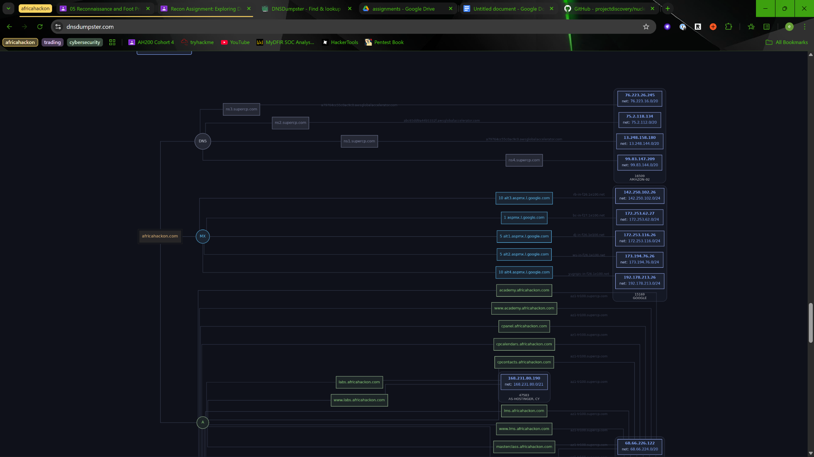
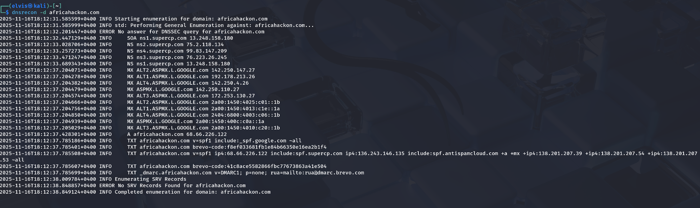
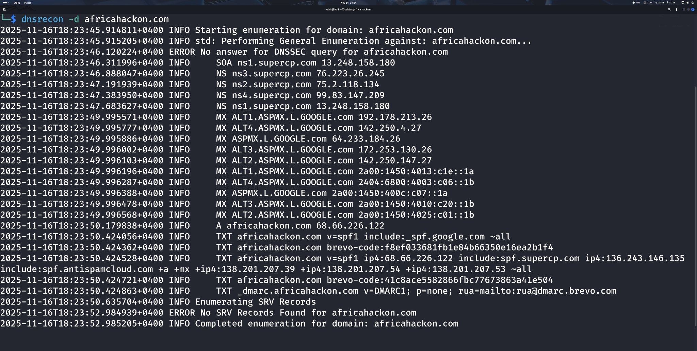
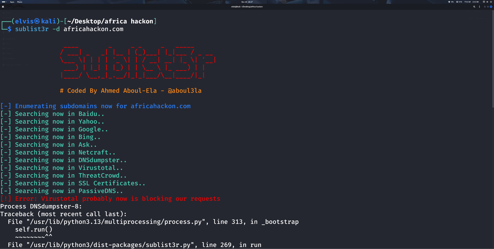
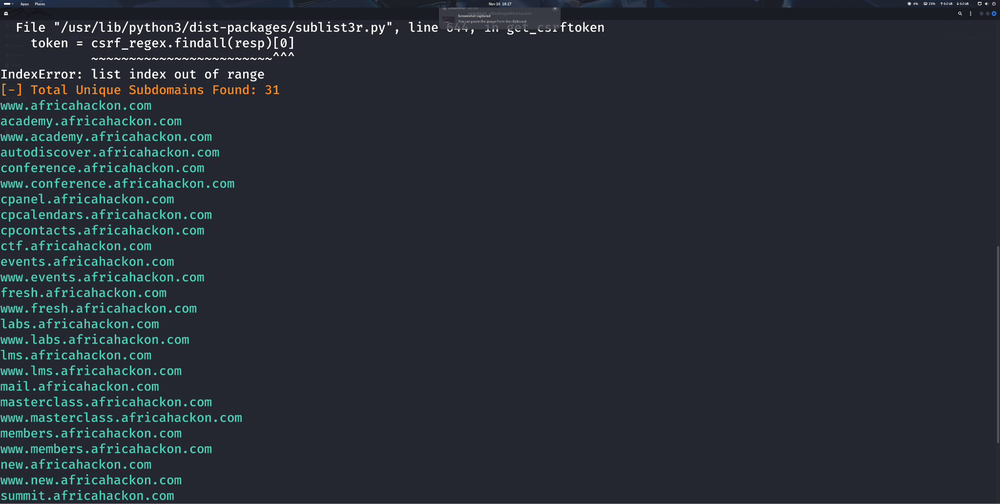
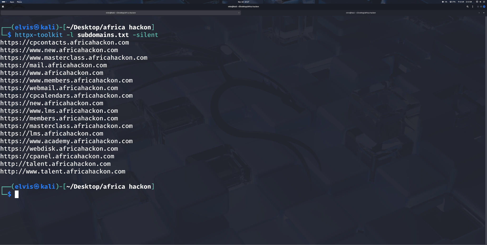
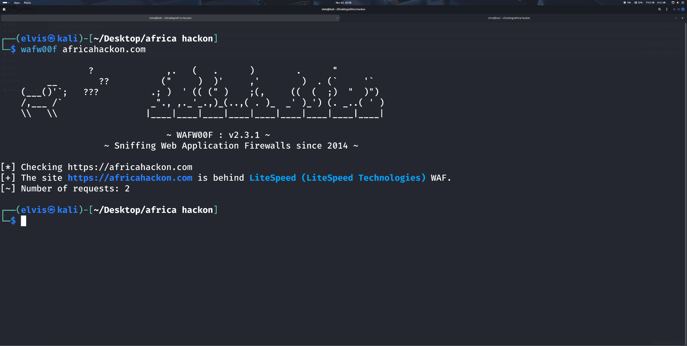

# External Attack Surface Reconnaissance

## Objective
Used multiple passive and active reconnaissance methods to enumerate subdomains, distinguish live from inactive assets, and inspect perimeter protections.

### Skills Learned
- Collected passive DNS and infrastructure relationships.
- Ran command-line subdomain enumeration and compared outputs.
- Separated responsive and non-responsive subdomains.
- Reviewed signs of firewall or edge protection on discovered hosts.

### Tools Used
- DNSDumpster
- DNSRecon
- Sublist3r
- DNS analysis
- host validation

## Steps

*Ref 1: DNSDumpster relationship map for africahackon.com showing discovered DNS, MX, and A-record infrastructure.*

*Ref 2: DNSRecon baseline enumeration identifying SuperCP name servers, Google mail exchangers, A records, SPF, Brevo TXT records, DMARC, and missing SRV records.*

*Ref 3: Follow-up DNSRecon run confirming the same DNS, mail, TXT, and DMARC records from the project working directory.*

*Ref 4: Sublist3r passive subdomain enumeration across public sources, including Baidu, Yahoo, Google, Bing, Netcraft, DNSDumpster, ThreatCrowd, SSL certificates, and PassiveDNS.*

*Ref 5: Sublist3r results listing 31 unique discovered subdomains, including academy, conference, cPanel, events, labs, LMS, mail, members, and summit hosts.*

*Ref 6: httpx-toolkit validation of subdomains.txt showing which discovered hosts responded over HTTP or HTTPS.*

*Ref 7: WAFW00F check identifying africahackon.com as protected by a LiteSpeed Technologies web application firewall.*

