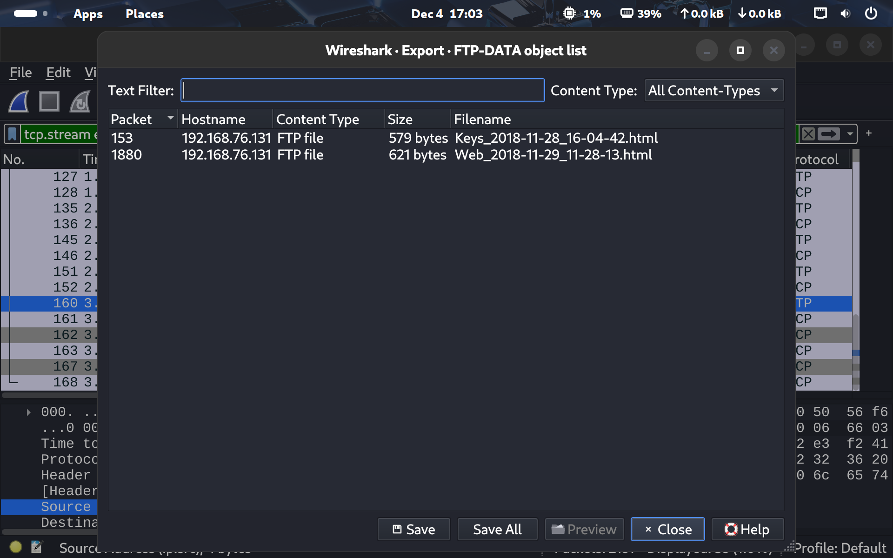
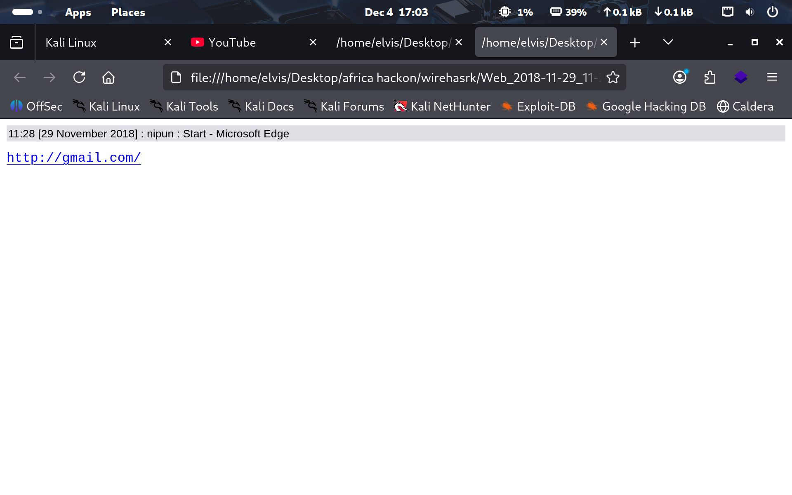
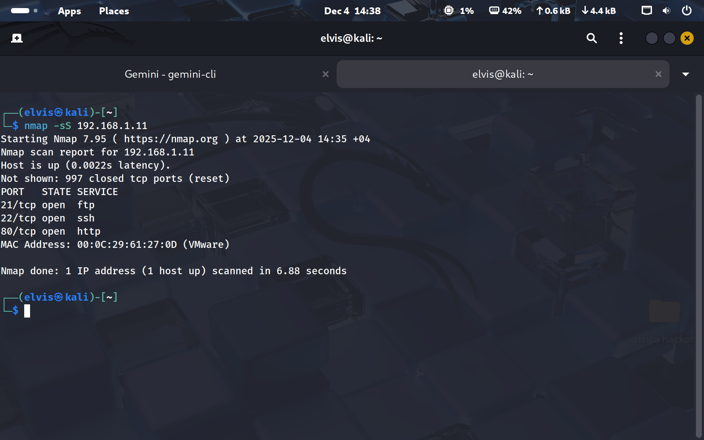

# Network Forensics and Snort Detection Engineering

## Objective
Investigated keylogger exfiltration in packet traffic and created Snort rules for ICMP and Nmap SYN-scan detection.

### Skills Learned
- Filtered traffic by protocol, host, port, flags, and credential-related strings.
- Traced keylogger exfiltration from the victim to attacker infrastructure.
- Recovered the username, password, URL, and two transferred HTML files.
- Created Snort rules for ICMP echo behavior and Nmap-style SYN packets with no payload.

### Tools Used
- Wireshark
- Snort
- PCAP analysis
- FTP/HTTP analysis
- Nmap traffic patterns

## Detection Rules
The Snort rules used in this lab are published as text in [`rules/local.rules`](rules/local.rules), transcribed from the Ref 5 screenshot and corrected as noted below.

| SID | Message | Logic |
|---|---|---|
| 1000001 | ICMP ECHO REPLY DETECTED | `itype:0` |
| 1000002 | ICMP ECHO REQUEST DETECTED | `itype:8` |
| 1000003 | TCP SYN STEALTH SCAN DETECTED | `flags:S,12; ack:0; dsize:0` |

**Changelog:** The screenshot originally labelled SID 1000001 (itype:0) as "ECHO REQUEST" and SID 1000002 (itype:8) as "ECHO REPLY". Only the `msg` strings were corrected so they match ICMP semantics (type 8 = Echo Request, type 0 = Echo Reply). Detection logic is unchanged.

## MITRE ATT&CK Mapping
| Technique | ID | Evidence in this lab |
|---|---|---|
| Input Capture: Keylogging | T1056.001 | Recovered keylogger artifact (Ref 3) |
| Exfiltration Over Alternative Protocol (unencrypted FTP) | T1048.003 | FTP-DATA transfer of keylogger HTML files to attacker host (Ref 2) |
| Network Service Discovery | T1046 | Nmap `-sS` scan detected by SID 1000003 (Refs 6, 8) |
| Remote System Discovery (ping sweep) | T1018 | ICMP echo traffic detected by SIDs 1000001/1000002 (Refs 7, 9) |

## Steps

*Ref 1: Wireshark Follow TCP Stream exposes the FTP password `Nipun@123` and confirms upload of the keylogger HTML artifact.*

*Ref 2: Wireshark FTP-DATA object export identifies the two transferred HTML files and their source host.*

*Ref 3: Recovered keylogger artifact shows the captured Windows Explorer activity for the Pictures directory.*

*Ref 4: Recovered browser artifact records the user `nipun` opening `http://gmail.com/` in Microsoft Edge.*

*Ref 5: Custom Snort local rules define ICMP echo request, ICMP echo reply, and TCP SYN stealth scan detections.*

*Ref 6: Snort alert output confirms the TCP SYN stealth scan rule triggers on Nmap `-sS` traffic.*

*Ref 7: Snort alert output verifies the ICMP request and reply rules during ping traffic between the monitored hosts.*

*Ref 8: Nmap SYN scan against `192.168.1.11` discovers open FTP, SSH, and HTTP services used to validate the Snort scan rule.*

*Ref 9: Ping test against `192.168.1.11` generates ICMP traffic used to validate echo request and echo reply alerts.*

